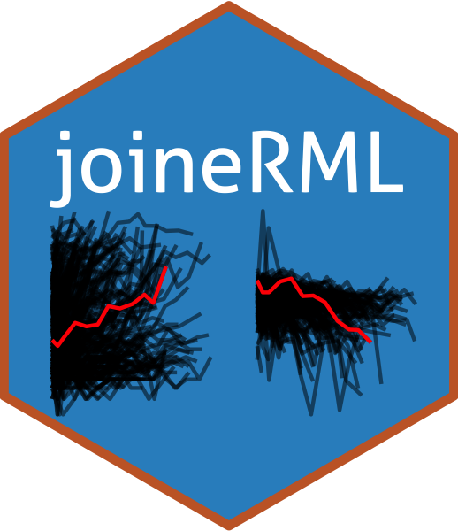

---
output:
  github_document:
    html_preview: false
    pandoc_args: ["--wrap=none"]
---

<!-- README.md is generated from README.Rmd. Please edit that file. -->

```{r setup, include = FALSE}
knitr::opts_chunk$set(collapse = TRUE, comment = "#>")
```

# joineRML 0.4.9 

<!-- badges: start -->
[](https://cran.r-project.org/package=joineRML)
[](https://github.com/graemeleehickey/joineRML/actions/workflows/R-CMD-check.yaml)
[](https://app.codecov.io/gh/graemeleehickey/joineRML)
[](https://www.gnu.org/licenses/gpl-3.0.html)
[](https://doi.org/10.5281/zenodo.1158231)
[](https://cran.r-project.org/package=joineRML)
<!-- badges: end -->

**joineRML** fits joint models for multiple continuous longitudinal outcomes and a time-to-event outcome. It combines multivariate linear mixed-effects models with a Cox proportional hazards model, estimated using Monte Carlo EM. The package also provides dynamic predictions, bootstrap inference, and model summaries in tidy tables.

## Installation

joineRML requires R 4.1.0 or later.

### CRAN release

Install the current CRAN release with:

```{r, eval = FALSE}
install.packages("joineRML")
```

### Development version

Version 0.4.9 is being prepared for submission to CRAN. Install the development version from GitHub with:

```{r, eval = FALSE}
install.packages("remotes")
remotes::install_github("graemeleehickey/joineRML")
```

Installation from GitHub requires a C++ compiler. On Windows, install [Rtools](https://cran.r-project.org/bin/windows/Rtools/) for your version of R. On macOS, install the Xcode Command Line Tools by running `xcode-select --install` in Terminal.

## Example

Use `mjoint()` to fit a joint model. This example models two longitudinal outcomes, log valve gradient and log left ventricular mass index, together with time to death in the `heart.valve` dataset. For this illustration, we retain visits with both longitudinal measurements observed.

```{r, eval = FALSE}
library(joineRML)
data(heart.valve)
hvd <- heart.valve[!is.na(heart.valve$log.grad) & !is.na(heart.valve$log.lvmi), ]

set.seed(12345)
fit <- mjoint(
  formLongFixed = list(
    grad = log.grad ~ time + sex + hs,
    lvmi = log.lvmi ~ time + sex
  ),
  formLongRandom = list(
    grad = ~ 1 | num,
    lvmi = ~ time | num
  ),
  formSurv = Surv(fuyrs, status) ~ age,
  data = list(hvd, hvd),
  timeVar = "time"
)
```

Inspect the estimates, obtain a tidy table with confidence intervals, and plot the convergence history of the survival-model parameters:

```{r, eval = FALSE}
summary(fit)
tidy(fit, conf.int = TRUE)
plot(fit, params = "gamma")
```

joineRML supplies the broom-compatible methods `tidy()`, `augment()`, and `glance()`. Approximate standard errors are calculated from the empirical information matrix; use `bootSE()` for bootstrap standard errors and confidence intervals. The functions `dynLong()` and `dynSurv()` provide subject-specific dynamic predictions for longitudinal outcomes and survival, respectively.

From version 0.4.9, you can pass `seed = 12345` directly to `mjoint()` instead of calling `set.seed()` before the fit. A supplied seed applies to that fit and preserves the previous R random-number state.

## Documentation

The [package website](https://graemeleehickey.github.io/joineRML/) includes:

- An [introductory vignette](https://graemeleehickey.github.io/joineRML/articles/joineRML.html) with worked examples.
- A [guide to tidy model summaries](https://graemeleehickey.github.io/joineRML/articles/joineRML-tidy.html).
- A [technical vignette](https://graemeleehickey.github.io/joineRML/technical.pdf) describing the model and estimation method.
- The complete [function reference](https://graemeleehickey.github.io/joineRML/reference/index.html).

For an installed CRAN package, you can also open the vignettes from R:

```{r, eval = FALSE}
vignette("joineRML", package = "joineRML")
vignette("joineRML-tidy", package = "joineRML")
vignette("technical", package = "joineRML")
```

## Citation

If you use joineRML in a publication, please cite:

Hickey GL, Philipson P, Jorgensen A, Kolamunnage-Dona R. joineRML: a joint model and software package for time-to-event and multivariate longitudinal outcomes. *BMC Medical Research Methodology*. 2018; **18**: 50. [doi:10.1186/s12874-018-0502-1](https://doi.org/10.1186/s12874-018-0502-1).

To obtain the citation and a BibTeX entry in R, run:

```{r, eval = FALSE}
citation("joineRML")
```

## Support

Report bugs or suggest improvements through [GitHub issues](https://github.com/graemeleehickey/joineRML/issues), or contact the maintainer, [Graeme L. Hickey](mailto:graemeleehickey@gmail.com).

## Funding

Development of joineRML was funded by the Medical Research Council (grant MR/M013227/1).
