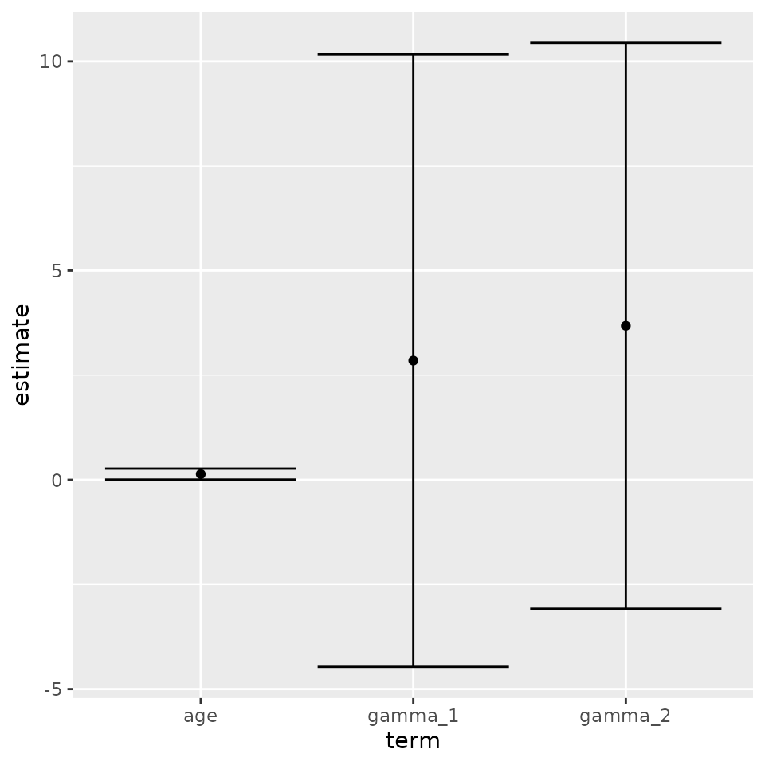

# joineRML and the broom package

## Introduction

joineRML provides three broom-compatible methods for fitted joint
models:

- [`tidy()`](https://generics.r-lib.org/reference/tidy.html) returns
  coefficient estimates, standard errors, and optional confidence
  intervals.
- [`augment()`](https://generics.r-lib.org/reference/augment.html) adds
  longitudinal fitted values and residuals to the original observations.
- [`glance()`](https://generics.r-lib.org/reference/glance.html) returns
  a one-row summary of model fit and sample sizes.

These methods support plots, model comparisons, and tables. They can be
used without loading broom; if broom is loaded, the same joineRML
methods are used regardless of package loading order. Unsupported
arguments cause an error rather than being silently ignored.

## Example

We use the sample example from the introductory vignette to `joineRML`
using the heart valve data.

``` r

vignette("joineRML", package = "joineRML")
help("heart.valve", package = "joineRML")
```

We analyse only the records with case-complete data for heart valve
gradient (`grad`) and left ventricular mass index (`lvmi`):

``` r

data(heart.valve)
hvd <- heart.valve[!is.na(heart.valve$grad) & !is.na(heart.valve$lvmi), ]
```

Further to that, we only select the first 50 individuals to speed up
these examples:

``` r

hvd <- hvd[hvd$num <= 50, ]
```

``` r

set.seed(12345)
fit <- mjoint(
  formLongFixed = list(
    "grad" = log.grad ~ time + sex + hs,
    "lvmi" = log.lvmi ~ time + sex
  ),
  formLongRandom = list(
    "grad" = ~ 1 | num,
    "lvmi" = ~ time | num
  ),
  formSurv = Surv(fuyrs, status) ~ age,
  data = list(hvd, hvd),
  timeVar = "time"
)
```

    ## Running multivariate LMM EM algorithm to establish initial parameters...

    ## Finished multivariate LMM EM algorithm...

    ## EM algorithm has converged!

    ## Calculating post model fit statistics...

### `tidy` method

The `tidy` method returns a tidy dataset with model estimates.

``` r

tidy(fit)
```

    ## # A tibble: 3 × 8
    ##   term    estimate std.error statistic p.value component outcome effect     
    ##   <chr>      <dbl>     <dbl>     <dbl>   <dbl> <chr>     <chr>   <chr>      
    ## 1 age        0.137    0.0665     2.05   0.0401 survival  event   fixed      
    ## 2 gamma_1    2.85     3.73       0.763  0.446  survival  grad    association
    ## 3 gamma_2    3.68     3.45       1.07   0.286  survival  lvmi    association

By default the `tidy` method returns the estimated coefficients for the
survival component of the joint model; however, it is possible to
extract each component by setting the `component` argument:

``` r

tidy(fit, component = "longitudinal")
```

    ## # A tibble: 7 × 8
    ##   term            estimate std.error statistic  p.value component outcome effect
    ##   <chr>              <dbl>     <dbl>     <dbl>    <dbl> <chr>     <chr>   <chr> 
    ## 1 (Intercept)_1    2.52       0.165     15.2   1.70e-52 longitud… grad    fixed 
    ## 2 time_1           0.00951    0.0307     0.310 7.56e- 1 longitud… grad    fixed 
    ## 3 sex_1            0.0344     0.231      0.149 8.82e- 1 longitud… grad    fixed 
    ## 4 hsStentless va…  0.0825     0.199      0.415 6.78e- 1 longitud… grad    fixed 
    ## 5 (Intercept)_2    4.99       0.0818    61.1   0        longitud… lvmi    fixed 
    ## 6 time_2           0.0258     0.0129     2.00  4.58e- 2 longitud… lvmi    fixed 
    ## 7 sex_2           -0.197      0.211     -0.934 3.50e- 1 longitud… lvmi    fixed

Use `component = "all"` to combine both components. The `component`,
`outcome`, and `effect` columns distinguish longitudinal fixed effects,
survival covariates, and latent association coefficients. Outcome labels
use the names supplied in `formLongFixed`, or the response expressions
if the list was unnamed. Existing coefficient names are retained.

``` r

tidy(fit, component = "all", conf.int = TRUE)
```

    ## # A tibble: 10 × 10
    ##    term       estimate std.error statistic  p.value conf.low conf.high component
    ##    <chr>         <dbl>     <dbl>     <dbl>    <dbl>    <dbl>     <dbl> <chr>    
    ##  1 (Intercep…  2.52       0.165     15.2   1.70e-52  2.20e+0    2.85   longitud…
    ##  2 time_1      0.00951    0.0307     0.310 7.56e- 1 -5.06e-2    0.0696 longitud…
    ##  3 sex_1       0.0344     0.231      0.149 8.82e- 1 -4.19e-1    0.488  longitud…
    ##  4 hsStentle…  0.0825     0.199      0.415 6.78e- 1 -3.08e-1    0.473  longitud…
    ##  5 (Intercep…  4.99       0.0818    61.1   0         4.83e+0    5.15   longitud…
    ##  6 time_2      0.0258     0.0129     2.00  4.58e- 2  4.84e-4    0.0512 longitud…
    ##  7 sex_2      -0.197      0.211     -0.934 3.50e- 1 -6.09e-1    0.216  longitud…
    ##  8 age         0.137      0.0665     2.05  4.01e- 2  6.17e-3    0.267  survival 
    ##  9 gamma_1     2.85       3.73       0.763 4.46e- 1 -4.47e+0   10.2    survival 
    ## 10 gamma_2     3.68       3.45       1.07  2.86e- 1 -3.08e+0   10.4    survival 
    ## # ℹ 2 more variables: outcome <chr>, effect <chr>

It is also possible to require confidence intervals to be calculated by
setting `conf.int = TRUE`, and modify the confidence level by setting
the `conf.level` argument:

``` r

tidy(fit, conf.int = TRUE)
```

    ## # A tibble: 3 × 10
    ##   term    estimate std.error statistic p.value conf.low conf.high component
    ##   <chr>      <dbl>     <dbl>     <dbl>   <dbl>    <dbl>     <dbl> <chr>    
    ## 1 age        0.137    0.0665     2.05   0.0401  0.00617     0.267 survival 
    ## 2 gamma_1    2.85     3.73       0.763  0.446  -4.47       10.2   survival 
    ## 3 gamma_2    3.68     3.45       1.07   0.286  -3.08       10.4   survival 
    ## # ℹ 2 more variables: outcome <chr>, effect <chr>

``` r

tidy(fit, conf.int = TRUE, conf.level = 0.99)
```

    ## # A tibble: 3 × 10
    ##   term    estimate std.error statistic p.value conf.low conf.high component
    ##   <chr>      <dbl>     <dbl>     <dbl>   <dbl>    <dbl>     <dbl> <chr>    
    ## 1 age        0.137    0.0665     2.05   0.0401  -0.0348     0.308 survival 
    ## 2 gamma_1    2.85     3.73       0.763  0.446   -6.77      12.5   survival 
    ## 3 gamma_2    3.68     3.45       1.07   0.286   -5.20      12.6   survival 
    ## # ℹ 2 more variables: outcome <chr>, effect <chr>

For the survival component, `exponentiate = TRUE` returns exponentiated
estimates and confidence limits. Standard errors and test statistics
remain on the log-hazard scale. For a baseline covariate, the
exponentiated coefficient is its conditional hazard ratio per unit
increase, holding other terms fixed. For an association coefficient, the
unit refers to its latent process rather than the observed marker.
Exponentiation is rejected for longitudinal or combined output.

``` r

tidy(fit, conf.int = TRUE, exponentiate = TRUE)
```

    ## # A tibble: 3 × 10
    ##   term    estimate std.error statistic p.value conf.low conf.high component
    ##   <chr>      <dbl>     <dbl>     <dbl>   <dbl>    <dbl>     <dbl> <chr>    
    ## 1 age         1.15    0.0665     2.05   0.0401   1.01        1.31 survival 
    ## 2 gamma_1    17.2     3.73       0.763  0.446    0.0115  25945.   survival 
    ## 3 gamma_2    39.7     3.45       1.07   0.286    0.0460  34187.   survival 
    ## # ℹ 2 more variables: outcome <chr>, effect <chr>

The standard errors reported by default are based on the empirical
information matrix, as in `mjoint`. It is of course possible to use
bootstrapped standard errors as follows:

``` r

bSE <- bootSE(fit, 
              nboot = 100, 
              safe.boot = TRUE, 
              progress = FALSE,
              ncores = 1L)
tidy(fit, bootSE = bSE, conf.int = TRUE)
```

The spelling `boot_se = bSE`, used by broom, is also accepted. Supply
only one of `bootSE` and `boot_se`. Both use the supplied bootstrap
standard errors in normal-approximation confidence intervals.

The results of this example are not included as it would take too long
to run for CRAN.

The `tidy` method is useful for custom plotting (e.g. forest plots) of
results from `joineRML` models, all in a tidy framework:

``` r

library(ggplot2)
out <- tidy(fit, conf.int = TRUE)
ggplot(out, aes(x = term, y = estimate, ymin = conf.low, ymax = conf.high)) +
  geom_point() +
  geom_errorbar()
```



### `augment` method

The `augment` method returns a dataset with added predictions from the
joint model. In particular, population-level and individual-level fitted
values and residuals are added to the data frame returned by the method:

``` r

preds <- augment(fit)
head(preds[, c("num", "log.grad", ".fitted_grad_0", ".fitted_grad_1", ".resid_grad_0", ".resid_grad_1")])
```

    ## # A tibble: 6 × 6
    ##   num   log.grad .fitted_grad_0 .fitted_grad_1 .resid_grad_0 .resid_grad_1
    ##   <fct>    <dbl>          <dbl>          <dbl>         <dbl>         <dbl>
    ## 1 1         2.30           2.60           2.42        -0.302        -0.113
    ## 2 1         2.30           2.64           2.45        -0.337        -0.148
    ## 3 1         2.30           2.65           2.46        -0.346        -0.158
    ## 4 10        2.20           2.56           2.40        -0.364        -0.201
    ## 5 10        2.20           2.60           2.43        -0.398        -0.236
    ## 6 11        3.69           2.61           2.65         1.08          1.04

``` r

head(preds[, c("num", "log.lvmi", ".fitted_lvmi_0", ".fitted_lvmi_1", ".resid_lvmi_0", ".resid_lvmi_1")])
```

    ## # A tibble: 6 × 6
    ##   num   log.lvmi .fitted_lvmi_0 .fitted_lvmi_1 .resid_lvmi_0 .resid_lvmi_1
    ##   <fct>    <dbl>          <dbl>          <dbl>         <dbl>         <dbl>
    ## 1 1         4.78           4.99           4.75       -0.214         0.0292
    ## 2 1         4.78           5.09           4.87       -0.309        -0.0867
    ## 3 1         4.92           5.11           4.90       -0.190         0.0267
    ## 4 10        5.14           5.10           5.06        0.0377        0.0723
    ## 5 10        5.13           5.19           5.17       -0.0635       -0.0397
    ## 6 11        5.03           5.00           5.05        0.0303       -0.0263

By default, rows follow the fitted subject-time order. Supplying
`data = hvd` returns the original observations in that dataset’s order,
matched by subject ID and measurement time. All original columns must be
present and unchanged; subject-time pairs must be unique if reordering
is needed. Outcomes with different observation schedules cannot be
combined into this single data frame.
[`augment()`](https://generics.r-lib.org/reference/augment.html) does
not accept `newdata`; use
[`dynLong()`](https://graemeleehickey.github.io/joineRML/reference/dynLong.md)
or
[`dynSurv()`](https://graemeleehickey.github.io/joineRML/reference/dynSurv.md)
for dynamic predictions.

We can plot the resulting predictions for four distinct individuals:

``` r

out <- preds[preds$num %in% c(26, 36, 227, 244), ]
ggplot(out, aes(x = time, colour = num)) +
  geom_line(aes(y = log.grad, linetype = "Measured")) +
  geom_line(aes(y = .fitted_grad_1, linetype = "Fitted")) +
  labs(linetype = "Type", colour = "ID", y = "Aortic gradient")
```


### `glance` method

The `glance` method allows extracting summary statistics from the joint
model:

``` r

glance(fit)
```

    ## # A tibble: 1 × 11
    ##   sigma2_1 sigma2_2   AIC   BIC logLik  nobs nevent  npar converged
    ##      <dbl>    <dbl> <dbl> <dbl>  <dbl> <int>  <dbl> <dbl> <lgl>    
    ## 1    0.517    0.158  342.  374.  -153.    43      8    18 TRUE     
    ## # ℹ 2 more variables: nobs_longitudinal_1 <int>, nobs_longitudinal_2 <int>

`nobs` is the number of subjects, agreeing with `nobs(fit)` and the
sample size used by BIC. `nevent` counts observed events, and
`nobs_longitudinal_1`, `nobs_longitudinal_2`, and so on count
measurements for each outcome in formula order. `npar` is the parameter
count used by AIC and BIC, excluding baseline hazard increments.
`converged` records whether the fitting criterion was met. The existing
`sigma2_j` columns contain residual standard deviations, despite their
historical names. These summaries are available even when post-fit
standard errors were not requested.

This allows comparing competing models easily. Say for instance that we
fit a second model with only random intercepts:

``` r

set.seed(67890)
fit2 <- mjoint(
  formLongFixed = list(
    "grad" = log.grad ~ time + sex + hs,
    "lvmi" = log.lvmi ~ time + sex
  ),
  formLongRandom = list(
    "grad" = ~ 1 | num,
    "lvmi" = ~ 1 | num
  ),
  formSurv = Surv(fuyrs, status) ~ age,
  data = list(hvd, hvd),
  timeVar = "time"
)
```

    ## Running multivariate LMM EM algorithm to establish initial parameters...

    ## Finished multivariate LMM EM algorithm...

    ## EM algorithm has converged!

    ## Calculating post model fit statistics...

We can go ahead and compare the models in terms of AIC and BIC:

``` r

glance(fit)
```

    ## # A tibble: 1 × 11
    ##   sigma2_1 sigma2_2   AIC   BIC logLik  nobs nevent  npar converged
    ##      <dbl>    <dbl> <dbl> <dbl>  <dbl> <int>  <dbl> <dbl> <lgl>    
    ## 1    0.517    0.158  342.  374.  -153.    43      8    18 TRUE     
    ## # ℹ 2 more variables: nobs_longitudinal_1 <int>, nobs_longitudinal_2 <int>

``` r

glance(fit2)
```

    ## # A tibble: 1 × 11
    ##   sigma2_1 sigma2_2   AIC   BIC logLik  nobs nevent  npar converged
    ##      <dbl>    <dbl> <dbl> <dbl>  <dbl> <int>  <dbl> <dbl> <lgl>    
    ## 1    0.515    0.173  342.  369.  -156.    43      8    15 TRUE     
    ## # ℹ 2 more variables: nobs_longitudinal_1 <int>, nobs_longitudinal_2 <int>

Compare AIC and BIC only for models fitted to the same observations, and
check convergence before interpreting the comparison.

### Extracting a model component

The following methods describe a selected longitudinal fixed-effects
model. Coefficient names and covariance-matrix names agree with its
design columns:

``` r

nobs(fit)
```

    ## [1] 43

``` r

terms(fit, process = "Longitudinal", k = 2)
```

    ## log.lvmi ~ time + sex
    ## attr(,"variables")
    ## list(log.lvmi, time, sex)
    ## attr(,"factors")
    ##          time sex
    ## log.lvmi    0   0
    ## time        1   0
    ## sex         0   1
    ## attr(,"term.labels")
    ## [1] "time" "sex" 
    ## attr(,"order")
    ## [1] 1 1
    ## attr(,"intercept")
    ## [1] 1
    ## attr(,"response")
    ## [1] 1
    ## attr(,".Environment")
    ## <environment: R_GlobalEnv>
    ## attr(,"predvars")
    ## list(log.lvmi, time, sex)
    ## attr(,"dataClasses")
    ##  log.lvmi      time       sex 
    ## "numeric" "numeric" "numeric"

``` r

head(model.frame(fit, process = "Longitudinal", k = 2))
```

    ##    log.lvmi      time sex
    ## 1  4.778955 0.0109589   0
    ## 2  4.778955 3.6794520   0
    ## 3  4.924569 4.6958900   0
    ## 43 5.137150 4.1205480   0
    ## 44 5.129366 7.7342470   0
    ## 45 5.027165 0.1534247   0

``` r

head(model.matrix(fit, process = "Longitudinal", k = 2))
```

    ##    (Intercept)      time sex
    ## 1            1 0.0109589   0
    ## 2            1 3.6794520   0
    ## 3            1 4.6958900   0
    ## 43           1 4.1205480   0
    ## 44           1 7.7342470   0
    ## 45           1 0.1534247   0

``` r

coef(fit, process = "Longitudinal", k = 2)
```

    ## (Intercept)        time         sex 
    ##  4.99293606  0.02584591 -0.19671311

``` r

vcov(fit, process = "Longitudinal", k = 2)
```

    ##               (Intercept)          time           sex
    ## (Intercept)  0.0066862346 -0.0002348949 -0.0015748512
    ## time        -0.0002348949  0.0001674460 -0.0005463331
    ## sex         -0.0015748512 -0.0005463331  0.0443159100

Model frames contain evaluated terms, including transformations. Fitted
contrasts are retained, so extraction is unaffected by subsequent
changes to the original dataset or R’s contrast options. These methods
extract the fitted observations and do not accept new data.

Use `process = "Event"` for the survival formula. Its design matrix
contains baseline covariates, without an intercept or latent association
columns. Event coefficient and covariance selections include both
baseline covariates and association coefficients:

``` r

head(model.matrix(fit, process = "Event"))
```

    ##         age
    ## 1  75.06027
    ## 43 72.12329
    ## 45 70.56712
    ## 51 50.97534
    ## 56 69.94247
    ## 62 72.30685

``` r

coef(fit, process = "Event")
```

    ##       age   gamma_1   gamma_2 
    ## 0.1365893 2.8471790 3.6800987

``` r

vcov(fit, process = "Event")
```

    ##                  age     gamma_1     gamma_2
    ## age      0.004427543 -0.03287174 -0.03879102
    ## gamma_1 -0.032871736 13.93535531 -6.12718700
    ## gamma_2 -0.038791016 -6.12718700 11.89414499

The default `coef(fit)` still returns the original parameter list, and
`vcov(fit)` still returns the covariance matrix for all main parameters.
Selecting longitudinal coefficients without `k` returns all outcomes,
retaining their numbered suffixes. Covariance extraction requires
available post-fit standard errors.

### Tables with modelsummary and gtsummary

These optional packages can format the extracted results. Supplying the
tidied estimates explicitly makes the selected component and reported
sample sizes clear.

For modelsummary, combine
[`tidy()`](https://generics.r-lib.org/reference/tidy.html) and
[`glance()`](https://generics.r-lib.org/reference/glance.html) in a
`modelsummary_list` object:

``` r

table_model <- structure(
  list(tidy = tidy(fit, conf.int = TRUE), glance = glance(fit)),
  class = "modelsummary_list"
)
modelsummary::modelsummary(
  list("Joint model" = table_model),
  gof_map = data.frame(
    raw = c("nobs", "nevent", "AIC", "BIC"),
    clean = c("Subjects", "Events", "AIC", "BIC"),
    fmt = c(0, 0, 1, 1)
  ),
  output = "markdown"
)
```

|          | Joint model |
|----------|-------------|
| age      | 0.137       |
|          | (0.067)     |
| gamma_1  | 2.847       |
|          | (3.733)     |
| gamma_2  | 3.680       |
|          | (3.449)     |
| Subjects | 43          |
| Events   | 8           |
| AIC      | 342.4       |
| BIC      | 374.1       |

For gtsummary, format the combined coefficient table directly. This
retains all outcome labels and avoids treating the joint model as a
single regression formula:

``` r

table_data <- tidy(fit, component = "all", conf.int = TRUE)
table_data <- table_data[c("component", "outcome", "term", "estimate",
                           "conf.low", "conf.high", "p.value")]
gtsummary::as_gtsummary(table_data) |>
  gtsummary::modify_header(
    component = "Component", outcome = "Outcome", term = "Term",
    estimate = "Estimate", conf.low = "Lower 95% CI",
    conf.high = "Upper 95% CI", p.value = "p-value"
  ) |>
  gtsummary::modify_fmt_fun(
    c(estimate, conf.low, conf.high) ~ gtsummary::label_style_number(digits = 3),
    p.value ~ gtsummary::label_style_pvalue(digits = 3)
  )
```

| Component | Outcome | Term | Estimate | Lower 95% CI | Upper 95% CI | p-value |
|----|----|----|----|----|----|----|
| longitudinal | grad | (Intercept)\_1 | 2.522 | 2.198 | 2.846 | \<0.001 |
| longitudinal | grad | time_1 | 0.010 | -0.051 | 0.070 | 0.756 |
| longitudinal | grad | sex_1 | 0.034 | -0.419 | 0.488 | 0.882 |
| longitudinal | grad | hsStentless valve_1 | 0.083 | -0.308 | 0.473 | 0.678 |
| longitudinal | lvmi | (Intercept)\_2 | 4.993 | 4.833 | 5.153 | \<0.001 |
| longitudinal | lvmi | time_2 | 0.026 | 0.000 | 0.051 | 0.046 |
| longitudinal | lvmi | sex_2 | -0.197 | -0.609 | 0.216 | 0.350 |
| survival | event | age | 0.137 | 0.006 | 0.267 | 0.040 |
| survival | grad | gamma_1 | 2.847 | -4.469 | 10.164 | 0.446 |
| survival | lvmi | gamma_2 | 3.680 | -3.079 | 10.440 | 0.286 |

### Additional examples

Several examples of how to use `broom` including more details are
available on its introductory vignette:

``` r

vignette(topic = "broom", package = "broom")
```
